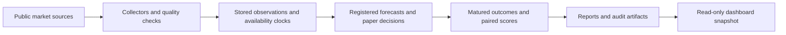
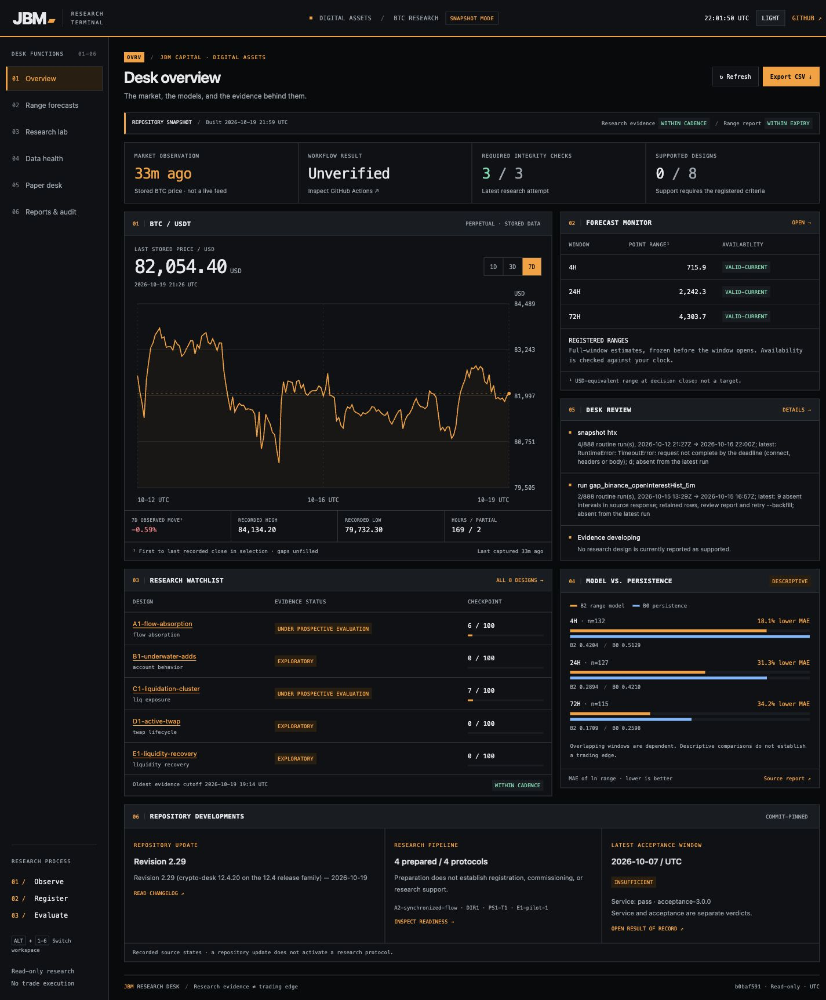

# JBM Research Desk

**A research terminal for digital assets.** Public market history, registered forecasts,
paper experiments, and auditable evidence in one repository.

[**Open dashboard ↗**](https://mannoj93-spec.github.io/jbm-desk-data/) ·
[Operational health](reports/health.md) · [Research evidence](reports/research.md) ·
[Market studies](reports/market_studies.md) · [Local preview](dashboard/README.md#local-preview)

The desk records what was available, freezes decisions before their evaluation windows, and
scores outcomes under declared rules. It collects market data and simulates paper decisions;
it does not place trades or edit trading skill files. Public market collection needs no
exchange trading credentials. Automated publication uses scoped GitHub credentials; see
[operations](docs/OPERATIONS.md).

> **Workflow success, fresh data, valid evidence, and research support are different things.**
> Read the relevant report's timestamps, exclusions, and maturity rules before interpreting a
> result. A green badge or a favourable chart does not establish a trading edge.

[](https://github.com/mannoj93-spec/jbm-desk-data/actions/workflows/release-check.yml)
[](https://github.com/mannoj93-spec/jbm-desk-data/actions/workflows/collect.yml)
[](https://github.com/mannoj93-spec/jbm-desk-data/actions/workflows/research.yml)
[](https://github.com/mannoj93-spec/jbm-desk-data/actions/workflows/market-studies.yml)

[All workflow runs](https://github.com/mannoj93-spec/jbm-desk-data/actions) include range publication,
scoring, monitors, recovery, research streams, and dashboard deployment.

**On this page:** [Start here](#start-here) · [Research programs](#research-programs) ·
[Reading the evidence](#reading-the-evidence) · [How it works](#how-it-works) ·
[Dashboard](#dashboard) · [Quick start](#quick-start) · [Repository map](#repository-map) ·
[Maintaining this guide](#maintaining-this-guide)

## Start here

| I want to know | Open |
|---|---|
| Is the collection service working? | [Operational health](reports/health.md) / [JSON](reports/health.json): native scheduling, recovery, service continuity, range/PS1 decisions, and scoring backlog |
| What data is present and how fresh is it? | [Coverage report](reports/latest.md): observation ages, stored history, source failures, and gaps |
| What has the research lab found? | [Research evidence](reports/research.md): per-design status, integrity, and checkpoints; [skill proposals](reports/skill_proposals.md) for proposed changes or why none are warranted |
| How are the range forecasts doing? | [Range report](reports/range.md) / [status JSON](reports/range_status.json); [model reference](desk/README.md) |
| Does options volatility add information? | [B1 companion report](reports/companion_b1.md): B2 versus B1 without DVOL, alongside the persistence comparison |
| Do range forecasts improve position sizing? | [PS1 report](reports/paper_ps1.md) and [protocol](desk/research/ps1/protocol.json): simulated sizing decisions and costs |
| How are the new experiments and pilots progressing? | [Market studies report](reports/market_studies.md) / [detailed JSON](reports/market_studies.json); [study guide](docs/MARKET_STUDIES.md) |
| Can the original research streams accumulate enough evidence? | [Feasibility report](reports/feasibility.md): coverage, warmup, limiting factors, and cautious checkpoint estimates; new studies have their own coverage report above |
| Where are issue-submitted forecast scores? | [Dated weekly reports](reports/); these are separate from the desk's hourly range scoring |
| What was tested, changed, or accepted? | [Validation record](VALIDATION.md), [changelog](CHANGELOG.md), and [acceptance evidence](docs/acceptance/) |
| How do I run, deploy, or investigate it? | [Quick start](#quick-start), [dashboard setup](dashboard/README.md), and [operations reference](docs/OPERATIONS.md) |

Counts, launch dates, ages, and current verdicts belong in generated reports, not this README.
Reports can have different cutoffs: check both generation time and the last included observation.

## Research programs

The original programs and the newer market studies keep separate records and evaluation clocks.
Adding a study does not restart PS1, RC1D, or the lab's historical evidence.

### Established programs

| Program | Question and evidence |
|---|---|
| Research lab | Pre-registered designs replay inputs as they were available, preserve decisions and checkpoints, and publish [evidence cards and reports](reports/research.md). Semantic changes start a new evaluation version. |
| RC1D range forecasts | Forecast full-window range magnitudes over 4h, 24h, and 72h against a persistence baseline. Quantiles are not directional price targets. See the [range model](desk/README.md). |
| B1 companion | Compare the same windows with and without DVOL (Deribit options-implied volatility). See the [stream specification](docs/RESEARCH_STREAMS.md). |
| PS1 paper sizing | Test sizing decisions with captured quotes, simulated fills, and explicit costs. It is a sizing experiment, not an entry signal. See the [PS1 protocol](desk/research/ps1/protocol.json). |

### Market studies v1: four prospective experiments

The [study guide](docs/MARKET_STUDIES.md) explains eligibility, publication deadlines, scoring,
review gates, and pause/resume procedures. The [frozen protocol](research_tools/market_studies/protocol.json)
is the exact specification; the [report](reports/market_studies.md) records each study's actual launch and progress.

| Experiment | What it tests | Primary comparison |
|---|---|---|
| Turnover control | Independent B2 and volatility-only accounts with 5% and 10% rebalance bands, each under ordinary and stressed costs; eight accounts using the same captured quote | Stressed-cost, duration-weighted log-return Sharpe: B2 10% minus B2 5%; higher is better |
| Range calibration | Daily trailing-window calibration of the 24h 80% range interval, leaving the point forecast unchanged | Calibrated minus original interval score; lower is better. Coverage and width are reported together |
| Continuous market state | Hourly observations, including ordinary periods, comparing price/volatility with added flow, positioning, and funding for 4h direction | Full model minus baseline Brier score (probability error); lower is better, on the same eligible sample |
| Paired spot/perpetual flow | Concurrent five-minute spot/perpetual bar captures; three arms separate added spot information from the effect of waiting for both sources | Combined minus perpetual-only 60m Brier score at a synchronized clock; lower is better. 15m outcomes and clock comparisons are secondary |

The turnover accounts collect their own executions; historical PS1 fills are not new evidence.
The paired-flow study uses minute bars, not subsecond execution data. Earlier observations used
for training remain training data, never prospective confirmation.

### Corrected market state v2

The [v2 protocol](research_tools/state_v2/protocol.json) fixes a depth-selection problem: an older
observation inside the flow window could hide a newer, still-aligned valid observation. V2 filters
for validity, freshness and alignment before ranking candidates, using the same rule in training
and prediction. The 30-minute age and 10-minute alignment limits remain fixed.

V2 runs alongside v1 with separate registration, activation, models, forecasts and scores under
`streams/market-studies/state-v2/`. Its report is generated at `reports/market_state_v2.md` and
`.json` after deployment; merge alone does not establish launch. The [study guide](docs/MARKET_STUDIES.md#corrected-state-study-v2)
explains its start clock and operational checks. V1 evidence remains unchanged and is never pooled
with v2. Data health separately shows recorded opportunities, eligible forecasts and abstentions. An external
verifier reproduces every v2 cached score from its original as-of outcome path without changing
the frozen study identity.

### Prospective options expiry-selection pilot

The [separately registered pilot](research_tools/options_pilot/protocol.json) compares the nearest
listed expiries with the nearest expiries that pass the existing leg filters, on the same hourly
capture. It uses no extrapolation and limits the alternate bracket to 14 days for the 7d target
and 35 days for the 30d target. It starts at the next UTC hour after its own code and registration
are confirmed on main; earlier captures are never counted as prospective observations.

Its own records live under `streams/market-studies/options-v2/`; deployment generates
`reports/options_expiry_pilot.md` and `.json`. Selected-contract order books add size observations
with separate source, request and receipt clocks. Later books cannot alter the original quote
eligibility. This measures feasibility, not predictive skill. See the
[pilot and operational guide](docs/MARKET_QUALITY.md) for limits, missing states and pause controls.

### Existing v1 data-quality pilots

| Pilot | What is collected | Interpretation boundary |
|---|---|---|
| Options usability | Per-leg and expiry quality, rejection reasons, 7d/30d 25-delta risk reversals (RR25), and eligible hourly changes | Existing filters stay fixed. Missing quote sizes remain unavailable; collection does not admit a predictive signal |
| Liquidation revisions | First and later captures of the same OKX hour, with raw responses, pagination status, and size/direction revisions | Incomplete or absent coverage is unknown, not zero liquidations. Revisions never replace first-seen predictors |
| Exchange stress | Binance ADL risk ratings and insurance-pool snapshots with source and receipt clocks, missing states, and variation | An ADL rating is not an auto-deleveraging event count; a pool can cover several symbols. This is a capability pilot, not a return-prediction test |

The v1 pilots and experiments write to [`streams/market-studies/v1/`](streams/market-studies/v1/).
Their [JSON report](reports/market_studies.json) retains exclusions, model/clock comparisons,
and pilot details beyond the readable summary. Prepared protocols elsewhere in the repository
and the [optional streaming recorder](stream/README.md) are not proof of a commissioned study.

The operational health report also separates options capture continuity from 7d/30d usability,
retains flat zero-trade source incidents and lists overlapping score windows. Recovery service-watch
and study-watch check results are shown separately from native scheduled-monitor heartbeats.
[Details and interpretation](docs/MARKET_QUALITY.md).

## Reading the evidence

| Signal | Where to check | What it establishes |
|---|---|---|
| Workflow success | [Actions](https://github.com/mannoj93-spec/jbm-desk-data/actions) | The named run passed its checks; it does not establish fresh inputs or a research result |
| Freshness and continuity | [Health](reports/health.md), [coverage](reports/latest.md), and the relevant study report | What was captured and published, when, and with which gaps; recovery activity is distinct from native scheduling |
| Integrity and eligibility | The relevant [lab](reports/research.md), [range](reports/range.md), [PS1](reports/paper_ps1.md), or [market study](reports/market_studies.md) report and its detailed artifacts | Whether records and comparisons pass their declared checks; valid records can still be too few to assess |
| Evidence maturity | Each program's report and frozen protocol | Whether its own sample, time, uncertainty, and review conditions are met; labels from one program do not transfer to another |

For market studies, **registration is not launch**. The protocol and implementation must first
be verified on main. Each study then needs its first on-time published forecast or verified
paper execution. Merging code, reaching a scheduled slot, or having training rows is insufficient.

Read scheduled, on-time published, and scored/executed counts together. Missing runs, unavailable
inputs, warmup, late publication, neutral signals, and pending outcomes have different meanings.
Missing outcomes are never scored as zero. A conditional hit rate excludes neutral signals;
use the primary paired score and coverage alongside it.

Market studies do not promote themselves automatically. Turnover has 180-/365-day checkpoints
and a 365-day floor for its first possible support review; the other primary studies have a
180-day review floor plus minimum blocks. A missing uncertainty interval means insufficient
blocks, not zero uncertainty. Full rules and guardrails remain in the
[study guide](docs/MARKET_STUDIES.md#interpretation-and-operations).

## How it works



| Pipeline | Intended cadence or trigger | Main output / reference |
|---|---|---|
| [Collector](.github/workflows/collect.yml) | Every 15 minutes; manual/backfill and recovery paths | Public market history, snapshots, captured books, and health reports |
| [Research lab](.github/workflows/research.yml) | Every 6 hours | Versioned research evidence, proposals, and coverage refresh |
| [Range publication](.github/workflows/range.yml) / [scoring](.github/workflows/range-score.yml) | Four-hour decisions / hourly scoring | Forecasts confirmed before windows open; matured outcomes and current status |
| [Research streams](.github/workflows/research-streams.yml) | After range runs, with a four-hour fallback | B1 companion, PS1, and feasibility reports |
| [Market studies](.github/workflows/market-studies.yml) | After Collector and Range forecasts, with a quarter-hour fallback | Registration, publication confirmation, paper executions, pilots, matured scores, and reports |
| [Forecast intake](.github/workflows/intake.yml) / [weekly report](.github/workflows/report.yml) | Issue events plus recovery / weekly | Frozen issue-submitted forecasts and their scores |
| [Dashboard](.github/workflows/dashboard.yml) | Relevant workflow completions, dashboard changes, and a half-hour fallback | Static snapshot with source hashes and checkout identity |

Workflow files are the source of truth for exact triggers. Scheduled times are targets;
queueing, late starts, and missing runs remain observable. The [recovery dispatcher](.github/workflows/recovery.yml)
and [operations reference](docs/OPERATIONS.md) describe service recovery and monitoring.
Writers publish only their allowed paths through the shared repository-write queue. The lab
also checks publication completeness before merging its computed outputs.

The [data catalog](research_tools/catalog.json) describes stored datasets, units, and availability
clocks as of its stated date; the new pilots are specified in the [market studies guide](docs/MARKET_STUDIES.md).
Use event time, receipt time, durable availability, and publication confirmation for their named
purposes. Historical backfill cannot recreate a missed live snapshot or turn a late forecast
into an on-time one.

## Dashboard

The dashboard is a read-only repository snapshot. Refresh loads the latest deployed snapshot;
it may lag repository reports. Market studies currently have dedicated reports linked above,
with operational coverage and deadline monitoring in the Data health view.

| Workspace | Purpose |
|---|---|
| Overview | Recorded BTC history, model comparisons, forecast availability, and research watchlist |
| Range forecasts | Full-window range quantiles, expiry, and descriptive scoring evidence |
| Research lab | Evidence cards, integrity, checkpoints, protocol readiness, and data catalog |
| Data health | Source coverage, timestamps, filters, operational health, and market-study coverage/deadline diagnostics |
| Paper desk | PS1 lifecycle and paired B2/B1 comparisons |
| Reports & audit | Commit-pinned reports, acceptance and supplementary audits, and exportable source hashes |

<details>
<summary>Dashboard preview — October 19, 2026 (dated observations, not live prices)</summary>



</details>

## Quick start

From a checkout of this repository, use **Python 3.12**, matching CI, and Git. The Python
pipeline and static dashboard build use the standard library; no dependency installation or
exchange keys are required. Dashboard JavaScript checks additionally use Node.js 22 in CI.

### Inspect and verify

These commands check the checkout or compute without publishing research records:

```sh
python --version                               # use Python 3.12
python test_fixtures.py                         # numerical fixtures
python scripts/check_checksums.py check         # maintained-file hashes and scope
python -m lab.run update --no-write              # compute and print; no research output writes
```

For the full regression suite, use the Ubuntu CI environment or a compatible environment with
Bash and GNU `timeout`; tests use temporary Git repositories and local loopback servers:

```sh
python -m unittest discover -s regression -v
python desk/research/o21_reanalysis.py verify
```

The [release workflow](.github/workflows/release-check.yml) requires the regression/numerical
suite and replay verification before checking checksums and the desk release identity. The
[validation record](VALIDATION.md) preserves release-specific evidence.

### Preview or regenerate local output

```sh
python scripts/build_dashboard.py               # writes .dashboard-build/
python -m http.server 8765 --bind 127.0.0.1 --directory .dashboard-build
```

Open <http://localhost:8765>. See [dashboard setup and checks](dashboard/README.md) for publishing
and browser validation. To regenerate coverage locally, `python report.py --coverage-only`
**rewrites `reports/latest.md`**; it does not score forecasts.

Live collection, backfill, registration, and publication are separate operations documented in
[operations](docs/OPERATIONS.md). Market study runtime stages are restricted to GitHub Actions
on main; use their [workflow and lifecycle guide](docs/MARKET_STUDIES.md) instead of attempting
a local launch. Never copy development results into prospective evidence.

## Repository map

| Path | Contents |
|---|---|
| `collector.py`, `enrich.py`, `hlsample.py`, `optionsbook.py`, `schema.py`, `storage.py` | Collection, sampling, and storage |
| `data/` | Stored market observations and collection records |
| `registry/` | Registered forecasts and provenance; [format reference](registry/README.md) |
| `state/` | Operational state, checkpoints, and scoring logs; some files are updated in place |
| `lab/`, `research/` | Research implementation and versioned decisions, outcomes, checkpoints, and evidence |
| `desk/` | Range model, fits, forecasts, companion, and PS1 jobs |
| `research_tools/` | Data catalog, research helpers, prepared-study tooling, and `market_studies/` runtime/protocol |
| `streams/` | Prospective stream records, including `rc1d-b1/`, `ps1/`, and `market-studies/v1/` |
| `market_study_ops.py`, `market_study_ops.json` | Read-only study coverage, fixed deployment comparison, depth freshness, paired-entry, and selected-options diagnostics; [operations](docs/MARKET_STUDIES.md#operational-recovery-and-diagnostics) |
| `reports/` | Generated summaries and detailed artifacts; latest reports are regenerated |
| `dashboard/`, `scripts/build_dashboard.py` | Static interface and snapshot builder |
| `scripts/`, `.github/workflows/` | Persistence guards, release checks, scheduling, and deployment |
| `regression/`, `test_fixtures.py` | Regression tests and numerical fixtures |
| `stream/` | Optional streaming recorder; [deployment status and requirements](stream/README.md) |
| `docs/`, `CHANGELOG.md`, `VALIDATION.md` | Operating guides, acceptance evidence, release history, and validation |

Historical records and frozen evidence have append-only or content-addressed contracts defined
by their owning pipeline. That does not make every file append-only: current reports, derived
indexes, and operational state can be regenerated or updated.

## Maintaining this guide

When adding or changing a program:

1. Add its question, output links, and interpretation boundary here. Keep exact thresholds,
   launch rules, and pause procedures in its protocol and operating guide.
2. Link the workflow and both readable and machine-readable reports when available. Distinguish
   prepared tooling, registered studies, verified launches, and data-only pilots.
3. Check repository-relative links and commands against the changed checkout. Label screenshots
   with capture dates; keep live counts and verdicts in generated reports.
4. For maintained-file edits, refresh and review `SHA256SUMS` with
   `python scripts/check_checksums.py refresh`, then run `python scripts/check_checksums.py check`.
   Stage newly added maintained files first so the checker includes them. The
   [checksum scope](scripts/check_checksums.py) excludes evolving data and generated reports.
5. Submit the change through the release checks. Research logic changes must follow the owning
   protocol's versioning rules; documentation alone must not reset evaluation clocks.
